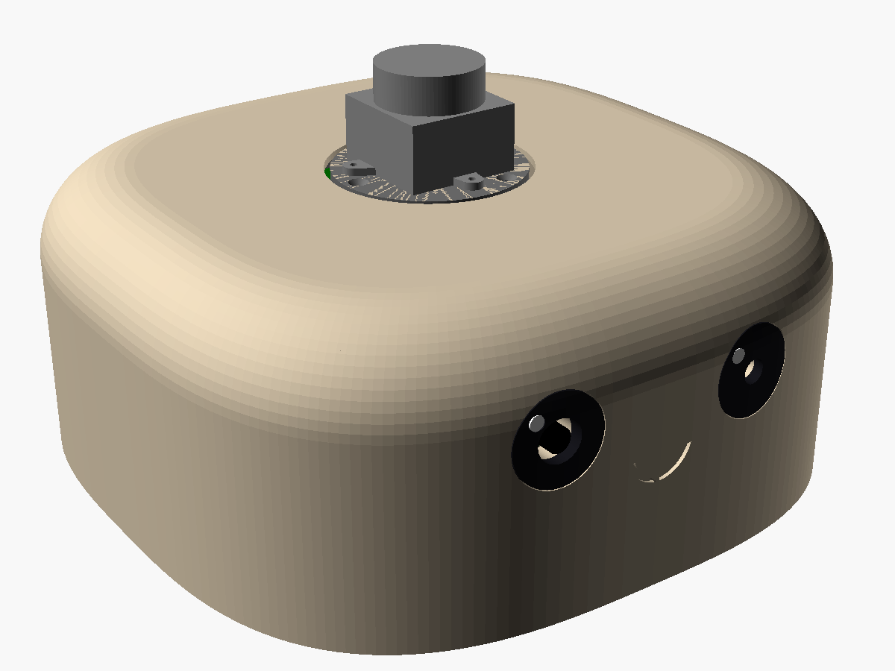
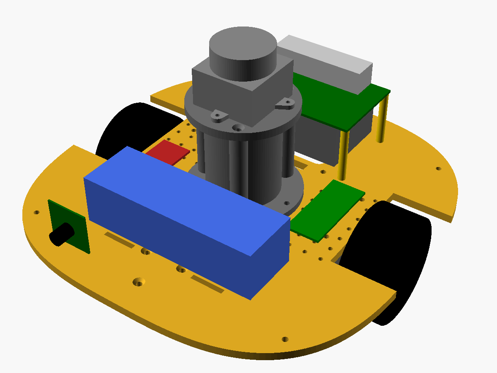
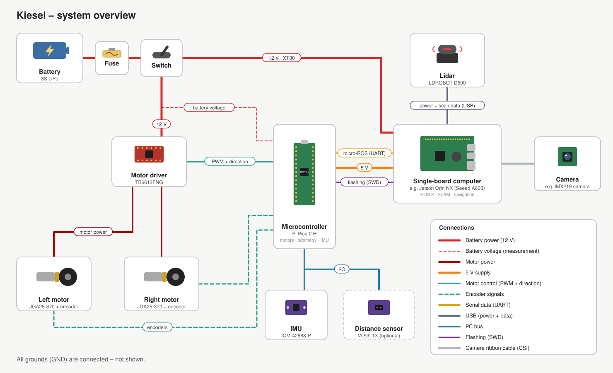

# Kiesel 🤖

Kiesel is going to be a small, pebble-shaped robot for indoor use: it should build a map of its surroundings on its own and navigate autonomously within it. Technically, it is a differential-drive robot running ROS 2, with a 360° lidar as its "hat", a camera in its right eye and a sand-colored, rounded-square shell with a friendly face (an original character design).

> **Status: planning phase.** The concept and a parametric CAD model are done, parts are being sourced. Nothing has been printed or programmed yet.

  
  

OpenSCAD model with placeholder components. Right, without the shell: battery (blue) at the front, lidar tower in the center, computer (Jetson Orin NX on its carrier) at the back. The camera board (left in the image) is actually mounted to the shell behind the right eye.

## What we're planning

1. **Build Kiesel** – 3D-print the shell, base plate and brackets ourselves and combine them with cheap off-the-shelf parts.
2. **Learn to drive** – microcontroller firmware with encoder reading, speed control and safety features; control via ROS 2 (`cmd_vel`), odometry back.
3. **Build a map** – create a map of the apartment with the lidar and `slam_toolbox`.
4. **Navigate autonomously** – use Nav2 to drive to goals on the map and avoid obstacles.
5. **Use the camera** – live view from the eye, maybe more later.

## Roadmap

### Phase 1 – Planning & sourcing *(current)*
- [x] Concept, component selection and design decisions
- [x] Parametric CAD model
- [ ] Order parts
- [ ] Open decisions: left eye (distance sensor or LED)

### Phase 2 – Mechanics
- [ ] Transfer measurements of the delivered parts into the CAD model (motor length, wheels, battery, lidar mounting, camera)
- [ ] Test prints: motor brackets, caster spacer block
- [ ] Print and assemble base plate, lidar tower and shell

### Phase 3 – Electronics & firmware
- [ ] Wiring: battery, motor driver, microcontroller ⇄ computer via UART
- [ ] Microcontroller firmware: encoder counting, PWM, PID speed control, IMU, battery monitoring, watchdog, micro-ROS

### Phase 4 – ROS 2
- [ ] URDF, bringup, lidar driver, camera
- [ ] Teleoperation, odometry calibration (wheel diameter, track width)
- [ ] Mapping with `slam_toolbox`
- [ ] Autonomous navigation with Nav2

## System overview

Generated from [`hardware/wiring/overview.py`](hardware/wiring/overview.py). Pin-level wiring will follow.

## Key specs (planned)

| | |
|---|---|
| Shell | ≈ 232 × 232 mm (rounded square), height ≈ 115 mm (≈ 150 mm with lidar), sand-colored PETG |
| Drive | 2 × JGA25-370, 12 V, 170 rpm, Hall encoders, 65 mm wheels |
| Track width | 176 mm (axle 12 mm behind the robot center) |
| Caster | front, swivel caster with 30 mm rubber wheel (handles door thresholds) |
| Battery | 3S LiPo (XT60), in front of the axle, 10 A fuse |
| Power | Single-board computer directly from the battery (9–20 V input); the microcontroller takes 5 V from its header |
| Motor driver | TB6612FNG |
| Microcontroller | Raspberry Pi Pico 2 H (RP2350), micro-ROS over UART |
| Single-board computer | NVIDIA Jetson Orin NX on a Seeed A603 carrier (any other SBC, e.g. a Raspberry Pi 5, works too) |
| Lidar | LDROBOT D500 (STL-19P), 360°, 0.03–12 m, 10 Hz |
| Camera | IMX219 camera (15-pin CSI) |
| IMU | TDK ICM-42688-P (6-axis), fused with wheel odometry |
| Optional | VL53L1X distance sensor (ToF) in the left eye |
| Speed | ≈ 0.5 m/s |

**Another single-board computer instead of the Jetson?** Kiesel stays universal: any SBC that fits behind the lidar tower can be used, e.g. a Raspberry Pi 5 (the base plate already has its mounting holes). SBCs that run on 5 V get a 12 V → 5 V buck converter (for the Pi 5: 5 A with USB-C output); the camera depends on the SBC (e.g. Pi Camera Module 3 for the Pi 5). Details in the docs, once published.

## Design overview

- **Base plate** carries everything: the motors hang below it in printed brackets; battery, computer, electronics and the lidar tower sit on top.
- **Lidar tower** stands directly on the base plate; the lidar sits on a deck plate that lies flush in an opening of the shell.
- **Shell** is a pure cover (4 screws) and can be lifted off over the lidar. Kiesel also drives without it. The eyes are separately printed black inserts.
- **Camera** looks through the pupil of the right eye; the left eye is reserved for a distance sensor or an LED.
