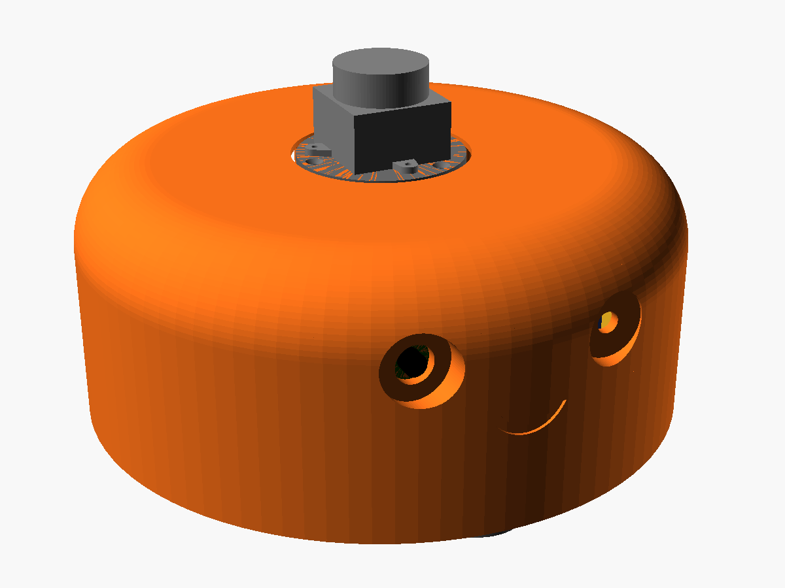
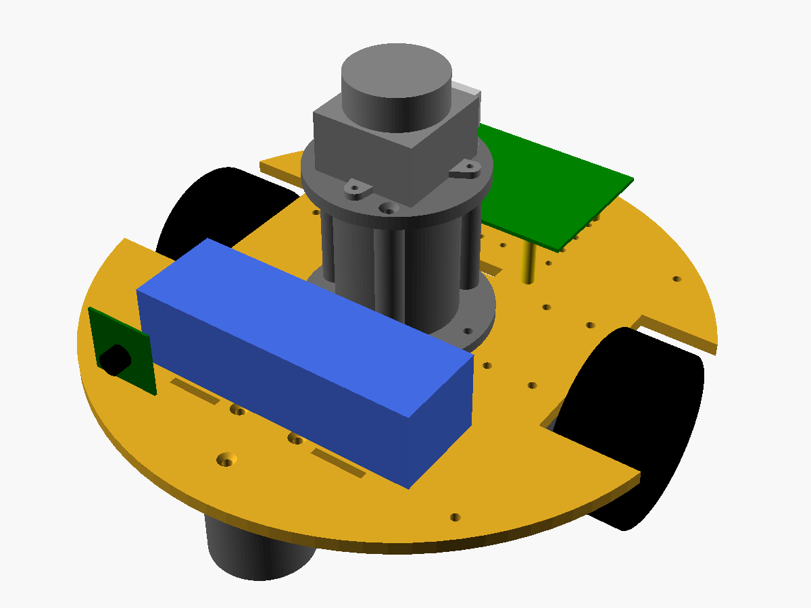

# Kiesel 🤖

Kiesel is going to be a small, round robot for indoor use: it should build a map of its surroundings on its own and navigate autonomously within it. Technically, it is a differential-drive robot running ROS 2, with a 360° lidar as its "hat", a camera in its right eye and a friendly orange shell (an original character design).

> **Status: planning phase.** The concept and a parametric CAD model are done, parts are being sourced. Nothing has been printed or programmed yet.

  
  

OpenSCAD model with placeholder components. Right, without the shell: battery (blue) at the front, lidar tower in the center, single-board computer (green) at the back. The camera board (left in the image) is actually mounted to the shell behind the right eye.

## What we're planning

1. **Build Kiesel** – 3D-print the shell, base plate and brackets ourselves and combine them with cheap off-the-shelf parts.
2. **Learn to drive** – microcontroller firmware with encoder reading, speed control and safety features; control via ROS 2 (`cmd_vel`), odometry back.
3. **Build a map** – create a map of the apartment with the lidar and `slam_toolbox`.
4. **Navigate autonomously** – use Nav2 to drive to goals on the map and avoid obstacles.
5. **Use the camera** – live view from the eye, maybe more later.

## Roadmap

### Phase 1 – Planning & sourcing *(current)*
- [x] Concept, component selection and design decisions
- [x] Parametric CAD model
- [ ] Order parts
- [ ] Open decisions: left eye (distance sensor or LED), caster

### Phase 2 – Mechanics
- [ ] Transfer measurements of the delivered parts into the CAD model (motor length, wheels, battery, lidar mounting, camera)
- [ ] Test prints: motor brackets, caster
- [ ] Print and assemble base plate, lidar tower and shell

### Phase 3 – Electronics & firmware
- [ ] Wiring: battery, motor driver, buck converter, microcontroller ⇄ computer via UART
- [ ] Microcontroller firmware: encoder counting, PWM, PID speed control, battery monitoring, watchdog, micro-ROS

### Phase 4 – ROS 2
- [ ] URDF, bringup, lidar driver, camera
- [ ] Teleoperation, odometry calibration (wheel diameter, track width)
- [ ] Mapping with `slam_toolbox`
- [ ] Autonomous navigation with Nav2

## Key specs (planned)

| | |
|---|---|
| Shell | Ø ≈ 232 mm, height ≈ 115 mm (≈ 150 mm with lidar) |
| Drive | 2 × JGA25-370, 12 V, 170 rpm, Hall encoders, 65 mm wheels |
| Track width | 176 mm (axle 12 mm behind the robot center) |
| Caster | front (printed with a 1" steel ball, or an off-the-shelf ball transfer unit) |
| Battery | 3S LiPo (XT60), in front of the axle |
| Motor driver | TB6612FNG |
| Microcontroller | Raspberry Pi Pico 2 H (RP2350), micro-ROS over UART |
| Computer | Raspberry Pi 5 |
| Lidar | LDROBOT D500 (STL-19P), 360°, 0.03–12 m, 10 Hz |
| Camera | Pi Camera Module 3 |
| Optional | VL53L1X distance sensor (ToF) in the left eye |
| Speed | ≈ 0.5 m/s |

## Design overview

- **Base plate** carries everything: the motors hang below it in printed brackets; battery, computer, electronics and the lidar tower sit on top.
- **Lidar tower** stands directly on the base plate; the lidar sits on a deck plate that lies flush in an opening of the shell.
- **Shell** is a pure cover (4 screws) and can be lifted off over the lidar. Kiesel also drives without it.
- **Camera** looks through the pupil of the right eye; the left eye is reserved for a distance sensor or an LED.
